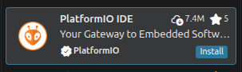
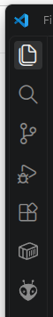

# roscon2026_workshop
Material for ROSCon Valencia 2026

## Docker image
If you don't have ROS2 installed in your computer, you can use the following docker:

```
docker pull ghcr.io/ramonvp/roscon2026_workshop:latest
```

The docker container mounts and shares a specific folder for easier editing:

```
mkdir ~/workspaces
```

The workshop repository provides a simple launcher, first clone the repo:

```
cd ~/workspaces
git clone https://github.com:ramonvp/roscon2026_workshop.git
```


Then to launch the container, simply

```
cd ~/workspaces/roscon2026_workshop
./docker/run.sh
```


## Building the code
First clone the repo with ros2serial source:

```
mkdir -p ~/workspaces/ws_rosserial/src
cd ~/workspaces/ws_rosserial/src
git clone https://github.com:ramonvp/ros2serial.git
cd ~/workspaces/ws_rosserial
colcon build --symlink-install
```

## Creating the ros2serial_lib for embedded
First create the Arduino project as described in the section below using PlatformIO. Then

```
source install/setup.bash
ros2 run rosserial_stm32 make_libraries <dest_path>/lib
```

Then compile and transfer to your Arduino from the PlatformIO IDE.

## Start the communication

In your ros2serial workspace:

```
ros2 launch rosserial_server serial.launch.py
```


## Install on macOS

```
brew install socat
```

## Building the image

To support multi-arch images, you need to make sure you have docker-container drive enabled:

```
docker buildx ls
```

If you get a default - docker output, then create it:

```
docker buildx create --name multiarch --driver docker-container --use
docker buildx inspect --bootstrap
```


## Setup PlatformIO
Create a directory for the embedded code and open Visual Studio Code inside:

```
mkdir -p arduino_ros2serial
code -n arduino_ros2serial
```

In VS Code, install the plugin named "PlatformIO IDE".


You might need to install this extra package:

```
sudo apt install python3-venv
```

Afterwards, you will have a new icon on the left vertical bar:


Open PlatformIO and Create New Project.

In the Wizard, select:
Name: arduino_ros2serial
Board: Arduino UNO
Framework: Arduino
